# Screenshots

Captured on an **iPhone 17 Pro simulator** (iOS, debug build) on 2026-10-11, with the status bar fixed at 9:41, then downscaled to 1000 px tall. Everything on screen comes from the fake server's seed. The avatars are placeholder portraits from pravatar.cc, and the post images are placeholder photos from picsum.photos.

## Light

| Login | Feed | Post |
|:---:|:---:|:---:|
| 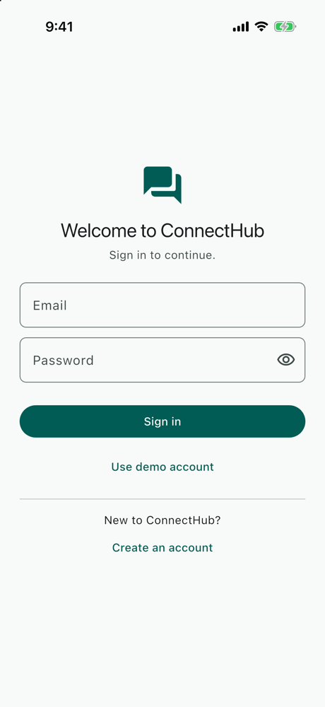 | 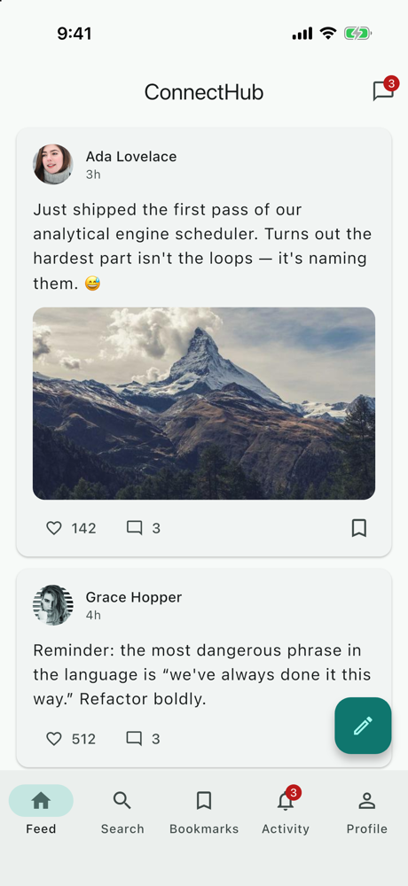 | 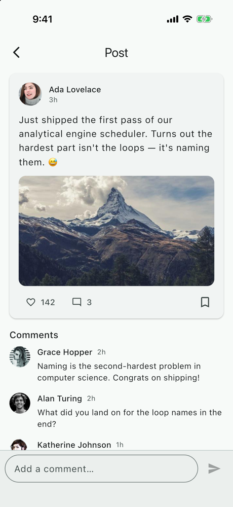 |

| Search | Someone else's profile |
|:---:|:---:|
| 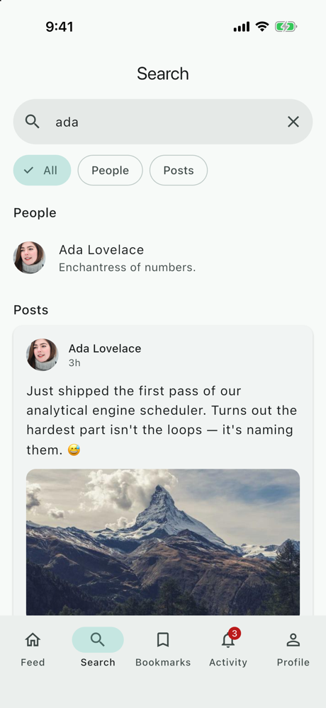 | 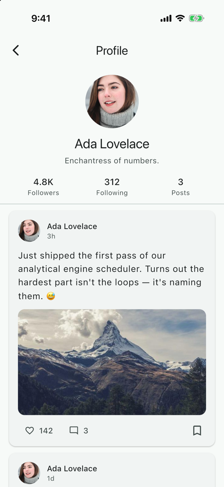 |

## Dark

| Chats | Chat | Activity |
|:---:|:---:|:---:|
| 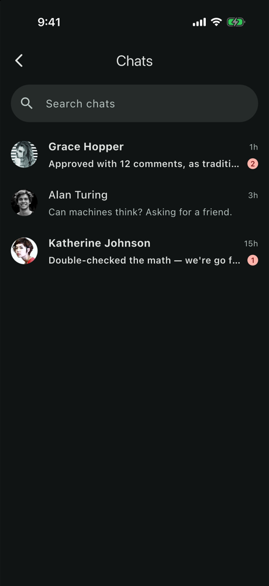 | 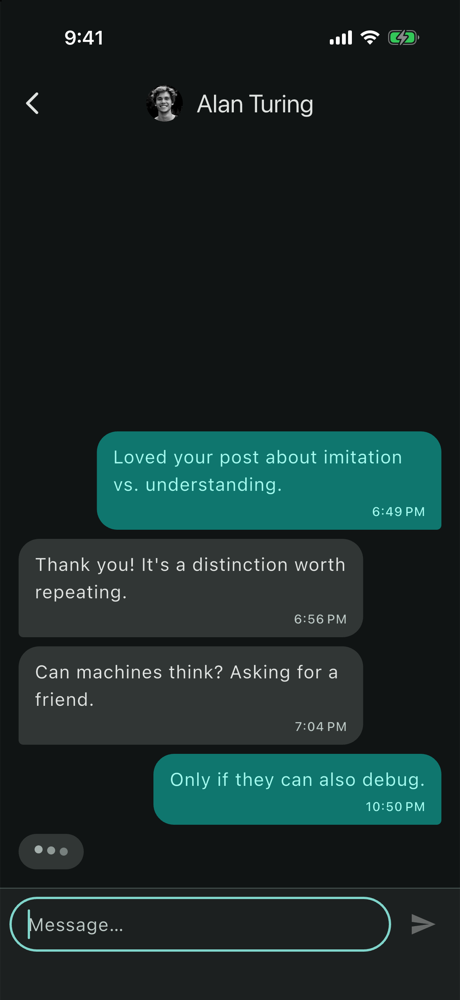 | 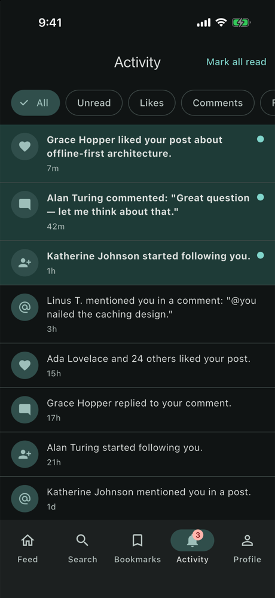 |

| My profile | Settings |
|:---:|:---:|
| 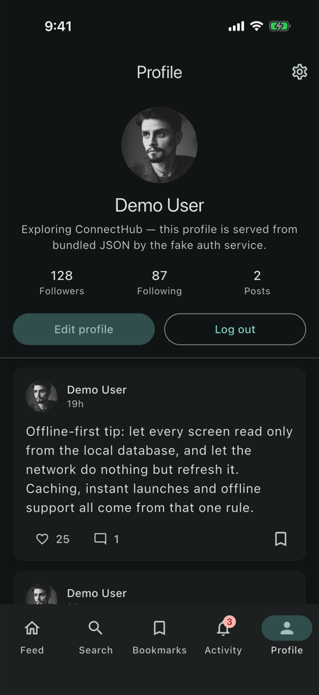 | 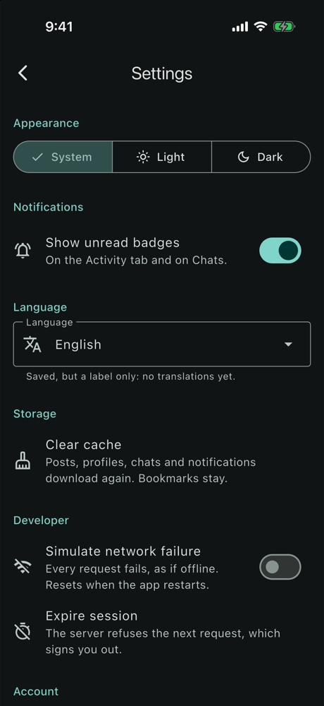 |

## Large text

Accessibility text size **AX3** (about 235 %), dark mode.

| My profile | Settings |
|:---:|:---:|
| 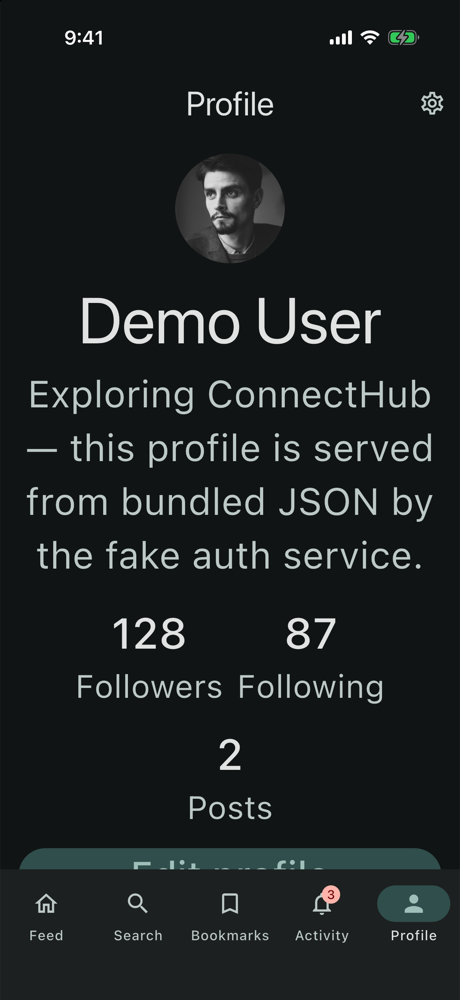 | 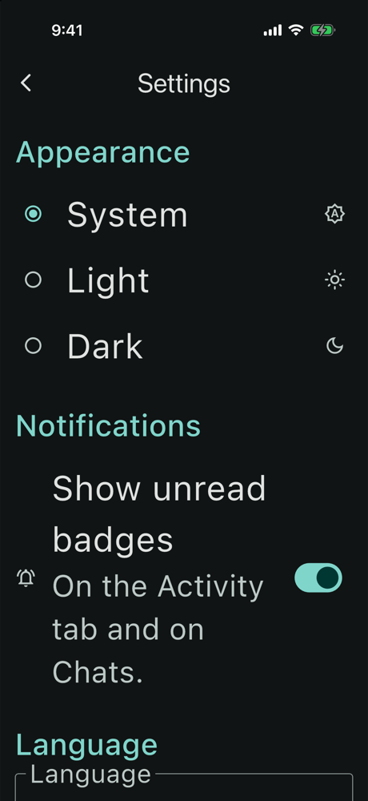 |

## What to look for

- **Dark mode** comes from the `SettingsCubit` above `MaterialApp.router`. In the dark screenshots, Settings is on "System" and the simulator is dark; choosing Light or Dark overrides it. The choice is read before the first frame, so a saved Dark never flashes light.
- **One source of truth:** Ada's post shows the same 142 likes and 3 comments on the Feed, the Post, Search and her profile, because every screen reads the same drift rows.
- **Live badges:** the Chats icon adds up the unread messages (Grace 2 + Katherine 1). The Activity tab counts the unread notifications. Both follow the cache, so they change as replies arrive and things are read.
- **The typing indicator** is pushed by the fake server's realtime channel 400 ms after a message; the reply follows 1.5 s later.
- **Unread rows** are bold in Chats, and highlighted with a dot in Activity.
- **Large text:**
  - the profile counts wrap onto rows instead of breaking words;
  - side-by-side controls (the Appearance buttons, Edit profile and Log out) stack vertically;
  - the tab labels keep their size, as on iOS's own tab bar (a long press shows the label).

## Retaking them

```bash
fvm flutter build ios --simulator --debug
xcrun simctl install booted build/ios/iphonesimulator/Runner.app
xcrun simctl launch booted co.bitfuse.flutter.connectHub

xcrun simctl status_bar booted override --time 9:41 --dataNetwork wifi --wifiBars 3 --cellularBars 4 --batteryState charged --batteryLevel 100
xcrun simctl ui booted appearance dark                              # or light
xcrun simctl ui booted content_size accessibility-extra-large       # AX3; "large" is the default

xcrun simctl io booted screenshot docs/screenshots/<name>.png
sips -Z 1000 docs/screenshots/<name>.png                            # downscale (macOS)

xcrun simctl status_bar booted clear                                # afterwards
```
